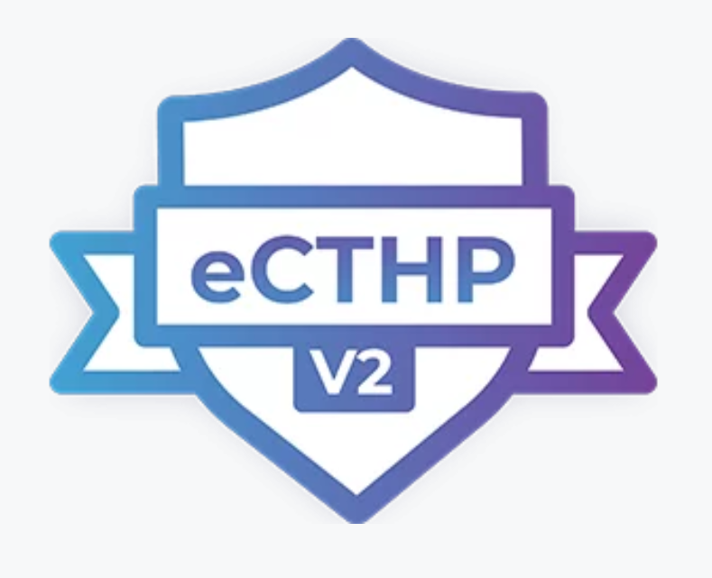

# eCTHP v2 Study Guide: Cyber Threat Intelligence and Threat Hunting



These independent eCTHP v2 study notes are for learners preparing for the Certified Threat Hunting Professional (eCTHP) certification and anyone building practical skills in cyber threat intelligence (CTI) and defensive threat hunting. The course moves from SOC and CTI foundations through collection and analysis, then applies that knowledge to hunt hypotheses, network and endpoint evidence, and an integrated capstone. It includes 18 lessons, original practice questions, and a synthetic-data lab.

> **Unofficial study aid.** This project is not created by, affiliated with, or endorsed by INE or any certification provider. Certification names and marks belong to their respective owners. Verify current exam objectives, eligibility, and course content with [INE](https://ine.com/learning/certifications). These notes do not reproduce the supplied course PDFs or provide exam answers.

## Choose a starting point

- **New to CTI or threat hunting?** Start with the [study plan](course/00-study-plan.md), then follow the [course map](course/INDEX.md) from the foundations onward.
- **Preparing for eCTHP?** Use the [eCTHP-focused study crosswalk](course/17-ecthp-study-crosswalk.md) alongside the [threat-hunting lessons](course/10-threat-hunting-fundamentals.md). The crosswalk is a study aid, not an official exam blueprint.
- **Ready to practice?** Work through the [synthetic hunt lab](labs/README.md), [original review questions](practice/README.md), and [integrated capstone](course/16-integrated-capstone.md).
- **Looking up a topic?** Browse the full [course index and learning outcomes](course/INDEX.md).

## What you will learn

- Translate organizational questions into intelligence requirements and a collection plan.
- Evaluate source reliability, information credibility, relevance, and confidence without overstating attribution.
- Use OSINT responsibly; normalize and enrich observables; understand STIX, TAXII, and TLP.
- Apply the Cyber Kill Chain and MITRE ATT&CK as complementary analytic models.
- Build scoped, testable hunt hypotheses from threat intelligence and local telemetry.
- Investigate network and endpoint evidence, document limitations, and turn validated findings into detections or response actions.

## Suggested sequence

1. Learn the CTI foundations and intelligence lifecycle.
2. Work through collection, OSINT, sharing standards, analysis, and dissemination.
3. Study threat-hunting strategy and hypothesis formation.
4. Practice network and endpoint investigations with authorized data.
5. Complete the capstone and review questions, writing down your reasoning before reading the explanations.

## Safe use

All investigation exercises are defensive. Use synthetic data, public training datasets, or systems for which you have explicit authorization. Do not collect personal data unnecessarily, probe third-party systems, reuse real credentials, or publish sensitive indicators without permission. See [the course scope](course/00-study-plan.md#scope-and-safe-practice).

## Contents

```text
.
|-- README.md
|-- REFERENCES.md
|-- CONTRIBUTING.md
|-- assets/
|   `-- ecthp-v2-badge.png
|-- labs/
|   |-- README.md
|   `-- synthetic-events.csv
|-- course/
|   |-- INDEX.md
|   |-- 00-study-plan.md
|   |-- 01-soc-and-cti-foundations.md
|   |-- 02-intelligence-types-and-indicators.md
|   |-- 03-intelligence-lifecycle.md
|   |-- 04-data-collection-and-quality.md
|   |-- 05-osint-method.md
|   |-- 06-sharing-standards.md
|   |-- 07-analytical-models.md
|   |-- 08-threat-intelligence-platforms.md
|   |-- 09-dissemination-and-feedback.md
|   |-- 10-threat-hunting-fundamentals.md
|   |-- 11-hunt-strategies-and-hypotheses.md
|   |-- 12-intelligence-driven-hunting.md
|   |-- 13-network-hunting.md
|   |-- 14-endpoint-hunting.md
|   |-- 15-analysis-detection-and-reporting.md
|   |-- 16-integrated-capstone.md
|   |-- 17-ecthp-study-crosswalk.md
|   `-- 18-glossary.md
`-- practice/
    `-- README.md
```

The course modules are original summaries and learning aids, not a substitute for official training or current exam objectives.
